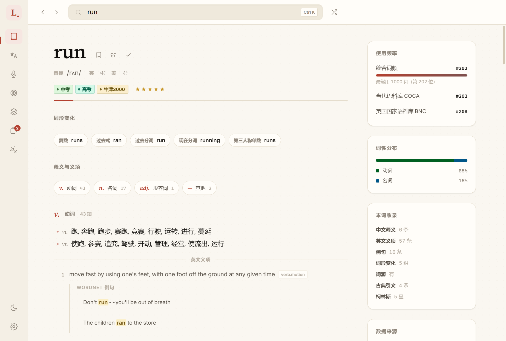
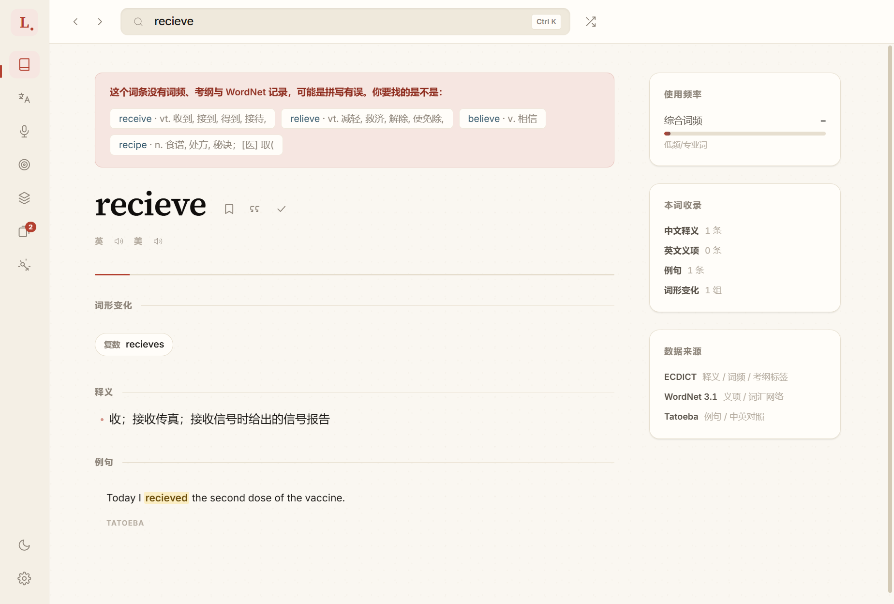
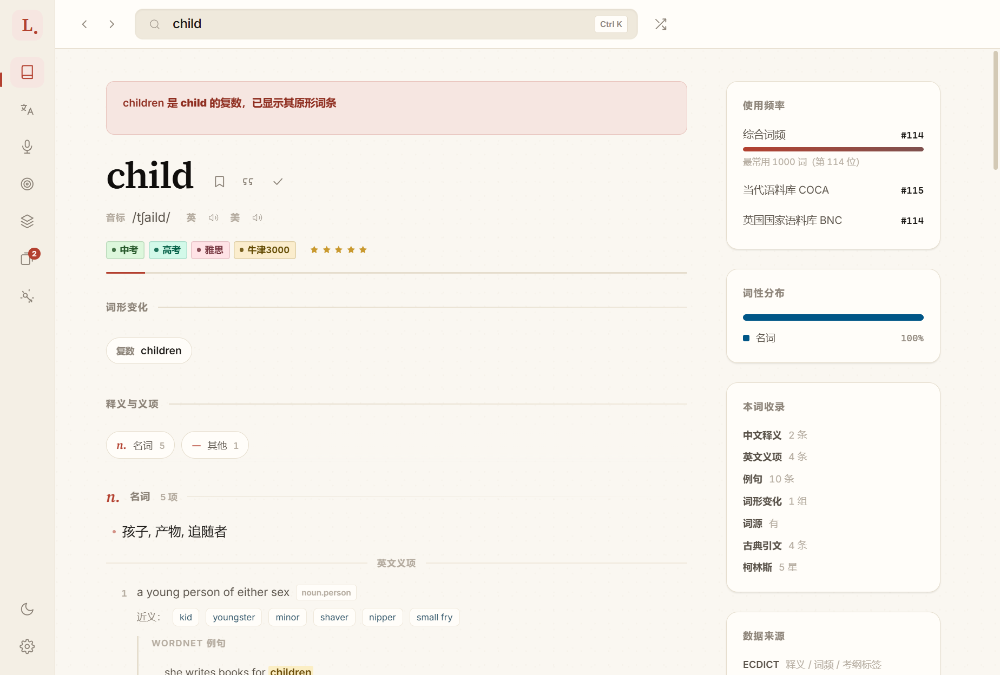
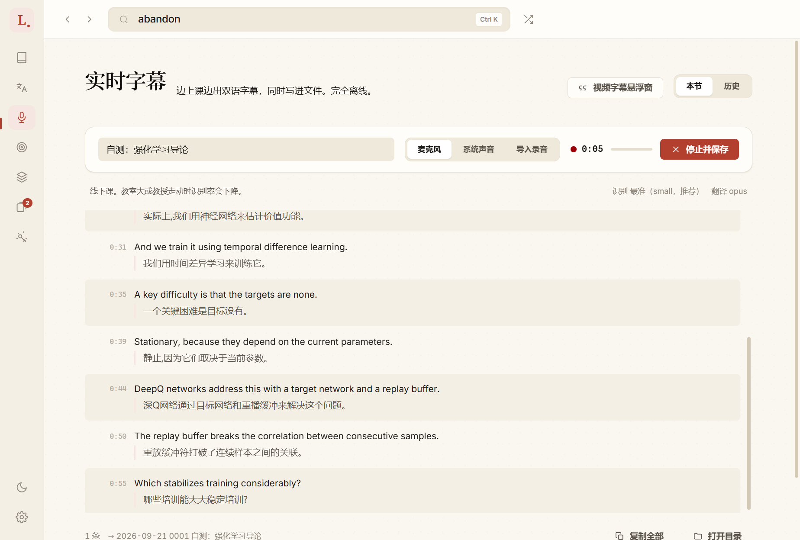

<div align="center">

<a href="https://liu-x27.github.io/lexica/">
<picture>
  <source media="(prefers-color-scheme: dark)" srcset="docs/brand/lockup-dark.svg">
  
</picture>
</a>

### `recieve` still resolves. It just ranks below `receive`.

A 3.4-million-entry English–Chinese dictionary and a real-time lecture captioner that
both run with the network cable pulled out, on Windows and Android from one source tree.


[](LICENSE)

**[Project page](https://liu-x27.github.io/lexica/)** · [The dictionary](#the-dictionary) · [Captions](#real-time-captioning) · [Two platforms](#one-source-tree-two-platforms) · [Running it](#running-it) · [中文说明](README.zh-CN.md)

</div>

<br>

| **3.40 M** | **3.24 M** | **21.1% → 8.0%** | **~80%** |
|:---:|:---:|:---:|:---:|
| entries from five open sources, in one 1,260 MB SQLite file | of them ranked down by one rule: no frequency rank, no Collins rating, no syllabus tag, no WordNet entry | of words recognised wrong on two hours of real conference talks, the first captioner against the current one | of a caption's delay is the speaker's pause; translation is 5% |

The interesting parts are the constraints. 1,260 MB of merged corpora searched through
SQLite FTS5, with a rule that demotes 3.24 M of the 3.40 M rows — everything carrying no
frequency rank, no Collins rating, no syllabus tag and no WordNet entry — below the 162 K
that keep at least one. Audio-processing throughput went from 0.58× to 4.0× real time on
my own hardware, by moving to a resident `whisper.cpp` server *and* bounding the encoder
context window against chunk length; the second change is the larger half. On two hours
of real conference talks the share of words recognised wrong then fell from 21.1% to 8.0%:
first by collapsing whisper's repetition loops, then by replacing chunk-by-chunk whisper with
a streaming model. And both the Windows desktop app and the Android
build come from the same source tree, bridged by a minimal CommonJS runtime and a
`node:sqlite` shim over Kotlin.

*[中文说明见 README.zh-CN.md](README.zh-CN.md) — the app's own UI is Chinese; this file
is the engineering overview.*



## The dictionary

Five open sources — ECDICT, WordNet, Tatoeba, GCIDE and a Chinese Wikipedia page dump
— merged into one 1,260 MB SQLite file: 1.36 M single words and 2.04 M phrases, with
senses grouped by part of speech,
WordNet glosses and example sentences, inflections, frequency ranks from COCA and BNC,
and exam-syllabus tags from middle school through GRE.

**The weak-entry problem.** ECDICT includes a large number of misspellings and bare
inflected forms as first-class entries. Searching naively, a query for a common word
returns a page of near-identical junk. The fix is a rule, not a model: a row is marked
weak when it carries no authority signal at all — no frequency rank, no Collins rating,
no exam-syllabus tag, and no WordNet entry. That is exactly where ECDICT's
web-aggregated misspellings (`recieve`, `wierd`) and bare inflections (`ran`, `mice`)
land, and it demotes 3.24 M of the 3.40 M rows below the 162 K that keep at least one
signal, while leaving every one reachable by exact lookup — so a typo still resolves,
but ranks below the retained headwords instead of above them. Below *those*, which is
not the same as never outranking any real word: a real word no source rated is weak
too. The flag is the `weak` column in `words`; search ranking and the spell-correction
candidate pool both order on it rather than filtering, which is what keeps exact lookup
working.



`recieve` is a real ECDICT row, and the four signals are all absent — the panel on the
right reads 低频/专业词 with zero English senses. So it resolves, and it says why it is
unlikely to be what you meant.



`children` redirects to `child`, where every signal is present: rank #114 in the combined
frequency list, #115 in COCA, #114 in BNC, four syllabus tags, Collins 5. Same lookup
path, opposite side of the rule.

**No native modules.** SQLite is Node's built-in `node:sqlite`, not `better-sqlite3`.
FTS5, the trigram tokenizer and custom functions all work through it, which means the
app installs on a machine with no MSVC build tools — the reason for the choice in the
first place.

## Real-time captioning

Live bilingual subtitles for a lecture, taken from the microphone, from system audio, or
from an imported recording, written to a file as they go. Entirely offline.



The English line is what the system is judged on. The Chinese under it comes from a
118 MB local `opus-mt` model and is a rough gloss — good enough to follow along, wrong
often enough that the transcript keeps both languages rather than replacing one with the
other. With a GPU it can come from [Hy-MT2](#hy-mt2-behind-a-number-guard) instead, which
scores ten BLEU points higher on the public benchmark below and is faster.

The recogniser is now a streaming model, NVIDIA's Nemotron, with whisper.cpp as the
fallback; [Streaming recognition](#streaming-recognition) has why and the measurements. The
whisper path came first, and getting it usable took three changes:

- **ONNX Whisper → a resident `whisper.cpp` server.** The ONNX path ran at 0.58× real
  time, i.e. falling behind a speaker permanently. Keeping a process warm and streaming
  chunks into it removes the per-chunk startup cost — necessary for real time, not
  sufficient on its own.
- **Bounding `--audio-ctx` against chunk length.** Shrinking the encoder context window
  is most of the speedup, but set it too small for a given chunk and the decoder
  degenerates into repeating the same phrase forever — with no error. The window is now
  derived from chunk length rather than fixed.
- **Beam search plus domain prompting**, for 0.8% WER — but see the conditions below
  before comparing that to anything.

**What those two numbers were measured on.** Neither is a benchmark result.

| | conditions |
|---|---|
| 0.58× → 4.00× | 5-second chunks, ONNX Whisper against a resident `whisper.cpp` server, my hardware |
| 0.8% WER | one 127-word clip synthesized from a lecture script, so there is a reference to score against — cleaner than a classroom; `small` + beam-5 + domain prompt; `npm run eval:asr` reproduces it |

The shipped default is that last configuration, and it runs at **9.1×** real time (9.9× on
another run). When the table was first measured, the same runtime and models gave it
3.7×, most likely because of the laptop's load or power mode that day; every WER came
back identical. And throughput is not latency: 9.1× says audio is processed faster than it
arrives, not how far behind a caption appears. The full
per-configuration table, including the two settings that made WER *worse*, is in the
[Chinese README](README.zh-CN.md#识别质量三个可调项的实测).

Silence-based chunking (`src/main/vad-chunker.js`) splits on pauses rather than a fixed
clock, adapts its threshold to the room's noise floor, and keeps a lead-in so the first
syllable of a sentence is not clipped.

### On a public benchmark

Everything above was measured on one synthetic clip. To get numbers anyone can reproduce,
the captioner now replays [MCIF](https://huggingface.co/datasets/FBK-MT/MCIF) — the 21 ACL
2023 talks that have Chinese reference translations (1.97 h, 919 sentences, CC-BY-4.0),
which are also the dev set of the IWSLT 2026 simultaneous track — through its own pipeline
in real time, and scores it the way that track does.

`LEXICA_BENCH` runs the app with no windows and drives the same IPC handlers the UI uses:
start a session, feed 2048-sample blocks against the wall clock exactly as the microphone
does, stop. The queueing, backlog dropping, translation routing and journal are the
production ones, not a reimplementation. Settings are the defaults apart from the
recogniser and translator each row names: rolling captions on, online translation off, no
glossary; whisper rows use `small` + beam-5 + domain prompt.

Latency is LongYAAL and LongLAAL from [OmniSTEval](https://github.com/pe-trik/OmniSTEval)
at the character level, from two timestamps per character that the journal now records:
*computation-unaware* (CU), the end of the audio chunk the character came from (for the
streaming recogniser, how much audio had arrived when its caption went out), and
*computation-aware* (CA), when the translation actually appeared. IWSLT 2026 bins systems
by CU LongYAAL into 0–2 s and 2–4 s. StreamLAAL is not reported: it needs mwerSegmenter,
which has no Windows build, and its Python packaging (`mweralign`) ships Linux wheels only.
LongLAAL is the same formula over OmniSTEval's own resegmentation.

| configuration | WER | BLEU | chrF | LongYAAL CU / CA | Chinese line after chunk end, median / p90 |
|---|---|---|---|---|---|
| CPU whisper + `opus-mt` (the old default) | 21.1% | 27.2 | 24.4 | 3.37 / 4.75 s | 1.11 / 1.77 s |
| CPU whisper + `opus-mt` + repeat guard (the fallback) | 14.7% | 29.2 | 24.6 | 3.43 / 4.72 s | 1.05 / 1.66 s |
| **Nemotron on the CPU + `opus-mt` (the default now)** | **8.0%** | **29.6** | 24.0 | **3.34 / 3.63 s** | 0.25 / 0.39 s |
| CPU whisper + Hy-MT2-7B on the GPU | 21.1% | 37.8 | 36.0 | 3.30 / 4.56 s | 1.07 / 1.57 s |
| CUDA whisper + Hy-MT2-7B on the GPU | 20.5% | 38.2 | 36.1 | 3.29 / 3.84 s | 0.36 / 0.75 s |
| CPU whisper + Hy-MT2-1.8B, no GPU at all | 21.1% | 35.8 | 35.6 | 3.20 / 5.60 s | 1.88 / 3.13 s |

Intel Core Ultra 9 275HX (24 cores), RTX 5080 Laptop GPU (16 GB), 32 GB RAM, Windows 11;
whisper.cpp b5130 (its CPU and CUDA 12.4 builds), NeMo-Speech.cpp 0.2.0 (CPU build),
llama.cpp b11190. For the Nemotron row the last column starts when a caption goes out (`cu`),
so it is translation alone; the wait for the pause is in CU. `npm run fetch:bench`
and `npm run bench` reproduce it; scoring needs a separate Python environment, listed in the
[Chinese README](README.zh-CN.md#公开基准mcif-上的端到端成绩).

What it says:

- **Streaming recognition halves the errors and gets the Chinese out sooner.** Same CPU, same
  `opus-mt`: WER 14.7% → 8.0% (insertions 984 → 313), BLEU 29.2 → 29.6, chrF 24.6 → 24.0,
  LongYAAL (CU) 3.43 → 3.34 s and (CA) 4.72 → 3.63 s. CA gains most because recognition happens
  while the speaker talks: when a caption is cut its English is already there, and only the
  translation is left. [Streaming recognition](#streaming-recognition) has how it got there,
  including a first run that was slower and translated worse. No GPU configuration has been
  run with it yet.
- **The synthetic clip flattered recognition.** 0.8% WER there, 21.1% here, 51.5% on the
  worst talk. The largest error class is insertions — 2,075 against 1,231 substitutions over
  16,797 reference words. 30 chunks come out at over 4.5 words a second because whisper
  loops (one 9-second chunk produced 171 words, the same sentence 14 times), and after a
  pause on a function word the next chunk often starts by saying that word again. Captions
  now go through a [repeat guard](#repetition-loops) first; the second row is the same pipeline
  with it: 14.7% WER, insertions down from 2,075 to 984, the worst talk from 51.5% to 26.2%.
- **Hy-MT2-7B is better and faster.** The first row and the CPU-whisper Hy-MT2-7B row share
  word-identical recognition,
  so the ten BLEU points are the translator alone. On the GPU it also translates a line in a
  median 163 ms against `opus-mt`'s 252 ms on the CPU, which it no longer fights whisper for.
  The number guard fired on none of the 1,248 lines.
- **Moving recognition to the GPU cuts the Chinese line's delay by two thirds.** CU latency
  barely moves, since it depends only on where the chunker cuts; CA drops by 0.7 s.
- **Without a GPU the switch is still worth it.** The last row never touches the GPU:
  Hy-MT2-1.8B shares the CPU with whisper and still scores 35.8 BLEU against 27.2. The price
  is about a second per line (median 999 ms), so the Chinese line lands 1.88 s after its chunk
  instead of 1.11 s (p90 3.13 s instead of 1.77 s). Recognition itself does not slow down.
- **The CUDA build is as accurate, not identical.** It matched the CPU build word for word on
  the synthetic clip, at 52× real time instead of 11×. Over two hours, 384 of 1,248 chunks
  differ (4.7% of words outside the looping chunks), and on the clip `base` with beam-5 went
  from 6.3% to 12.6% WER — floating-point differences send beam search down other paths.
  The shipped settings never use `base` with beam search.

### Streaming recognition

whisper hears a lecture one chunk at a time. The captioner cuts at pauses and sends each
chunk on its own, so no chunk knows what the last one said: a sentence cut at a hesitation
comes back as two fragments, a chunk that opens on the tail of a word turns it into another
word, and loops the guard below does not recognise still get through. After the guard,
14.7% of words were still wrong.

The default recogniser is now NVIDIA's
[Nemotron Speech Streaming EN 0.6B](https://huggingface.co/nvidia/nemotron-speech-streaming-en-0.6b),
a cache-aware FastConformer-RNNT, run by NVIDIA's
[NeMo-Speech.cpp](https://github.com/NVIDIA/NeMo-Speech.cpp) 0.2.0. It is wired up the same
way as whisper.cpp: the prebuilt Windows `nemo-speech serve` runs as a child process (CUDA
build with an NVIDIA GPU, CPU build otherwise), so there are still no native modules. Audio
goes into its realtime WebSocket continuously, the encoder keeps about 4.5 s of context
cached, words come back every 0.56 s, and a final arrives when the speaker pauses. On this
machine's CPU it runs at about 8× real time.

To choose it I replayed all 21 talks offline. The chunk-based rows run the exact chunks the
app cuts: the harness reproduces the benchmark's whisper transcript word for word. The
streaming rows hear each talk as one stream. Scoring is the same WER as the benchmark, and
the repeat guard is on for every whisper row.

| recogniser | how it hears a talk | WER | substitutions / deletions / insertions |
|---|---|---|---|
| whisper `small`, beam-5, domain prompt | chunks | 14.7% | 1,218 / 260 / 984 |
| whisper `medium.en`, beam-5, domain prompt, full window, GPU | chunks | 12.5% | 1,056 / 575 / 460 |
| whisper `large-v3-turbo`, beam-5, domain prompt, full window, GPU | chunks | 10.0% | 858 / 224 / 601 |
| Nemotron EN 0.6B | chunks | 9.3% | 1,017 / 166 / 380 |
| **Nemotron EN 0.6B**, the benchmark run below | one stream | **8.0%** | 886 / 151 / 313 |
| Parakeet TDT 0.6B v3, GPU | chunks | 9.7% | 904 / 252 / 474 |
| Nemotron 3.5 0.6B, multilingual, told `en-US`, 1.12 s steps | one stream | 9.4% | 1,094 / 201 / 277 |

On the same chunks, Nemotron alone takes 14.7% to 9.3%. Hearing the talk as one stream takes
it to 8.0%, with fewer substitutions (1,017 → 886) and fewer insertions at chunk seams
(380 → 313). The multilingual Nemotron 3.5 is worse at English than the English-only model.

Bigger whisper models were the first idea, and both lose to Nemotron on the same chunks.
Configured the way `small` is, with the encoder window bounded to the chunk length (which is
what makes whisper fast enough here) and the domain prompt carried, `large-v3-turbo` loops far
more than `small`: 22.3% against 10.1% on the first talk, with phrases like *"introducing
addition, and addition, and addition"*. With the full 30-second window, which at that size
needs a GPU, it reaches 10.0%. That row has the fewest substitutions in the table, so it hears
words well, but it still says things twice: 601 insertions. `medium.en` with the same window
drops words instead (575 deletions). Parakeet TDT v3 (6.34% average on the Open ASR
leaderboard sets, per its model card) only transcribes whole utterances, so it was tried on
the chunks: fewer substitutions than Nemotron there, more insertions. The two large whisper
rows and Parakeet ran on the GPU, the rest on the CPU.

**The first full run was slower and translated worse.** With the runtime's defaults (1.12 s
steps, a final after 800 ms of silence) and my first caption rules, the real-time benchmark
gave 8.1% WER but LongYAAL (CU) 5.02 s against whisper's 3.43 s, and BLEU 28.6 against 29.2.
Two causes:

- A final needs 800 ms of silence, and the server only checks between 1.12 s steps, so
  captions went out a median 1.2 s after the last word. whisper's chunker cuts 0.42 s after it.
- 84% of the captions had no final punctuation and 63% started in lower case (whisper's
  chunks: 13% and 3%), because the model only emits a full stop once the next word arrives.
  `opus-mt` translates fragments like that worse.

Both are fixed, measured offline: I recorded the server's raw event stream for every talk at
several settings and replayed the caption logic over it. The replay of the first settings
reproduces the benchmark run exactly, 1,187 captions and the same WER. Latency here is LongYAAL
(CU) on the English captions, character by character, which ran 0.25–0.3 s below the Chinese
figure for both whisper and Nemotron.

| steps | final after | WER | English-side LongYAAL (CU), first rules → current rules |
|---|---|---|---|
| 1.12 s | 800 ms | 8.1% | 4.59 → 4.07 s |
| 1.12 s | 500 ms | 8.7% | 3.55 → 3.09 s |
| **560 ms** | **500 ms** | **8.0%** | **3.71 → 3.08 s** |
| 160 ms | 500 ms | 8.5% | 3.07 → 2.57 s |
| *whisper `small`* | | *14.7%* | *3.15 s* |

Shorter captions come out sooner but translate a little worse, so the caption rules were
picked on the Chinese side: the same captions re-translated with the app's `opus-mt`, each
sent as a closed sentence (first letter capitalised, a full stop added when there is none),
which alone took the first run's BLEU from 28.6 to 30.1.

| 560 ms steps, caption rules | BLEU | chrF | LongYAAL (CU) |
|---|---|---|---|
| hold ≤ 5 s, emit at a pause after ≥ 2.5 s, cap 9 s | 30.1 | 24.5 | 3.94 s |
| hold ≤ 3 s, ≥ 2 s, cap 7 s | 29.9 | 24.2 | 3.64 s |
| **hold ≤ 2 s, ≥ 1.5 s, cap 6 s, flush after 1 s of silence** | **29.6** | **24.0** | **3.33 s** |
| *whisper `small` + guard, benchmark run* | *29.2* | *24.6* | *3.43 s* |

These settings were chosen on the same 21 talks they are scored on, which flatters them a
little. The table they came from is small, though, and the trend in it is steady.

**Cutting the stream into captions** (`src/main/stream-captions.js`). The model's finals
follow pauses, not sentences. In the first minute of one talk it sent *"What is"* as a
final of its own, then *"simultaneous speech translation? Simultaneous speech translation or
simulst is…"* eight seconds later. Translating each final would translate half-sentences,
and waiting for finals would hold a long sentence for ten seconds. The partial text, though,
only ever grows. So a sentence goes out the moment its full stop is followed by the next word
(the question above went out at 20.2 s instead of 28.0 s). A pause produces a caption once
1.5 s have built up and the text does not end on a function word or a comma; text that does
end that way is held for the next final, unless it is already 2 s long. Nothing grows past
6 s: the cut goes at the latest sentence end, pause or comma that still leaves at least 1.5 s
(without that floor, the 6.2 s opening of one talk split off a caption that was just *"Hi,"*,
which `opus-mt` rendered as 嗨,我很高兴见到你). Partials are the rolling caption, so the second
whisper server that used to re-transcribe the buffer every 1.5 s is not started. Imported
recordings use the longer first rules, since latency does not matter there.

The runtime can also end a final in the middle of a word: 3 of the 1,693 captions in the
benchmark run did, like one that ended *"…whether the mod"* before the next began *"el's
acceptability…"*. That is left alone; fixing it would take a dictionary lookup in the
caption path.

Two timestamps per caption, because with streaming they differ: `t0`–`t1` is when the words
were spoken (subtitle files use it), and `cu` is how much audio had arrived when the caption
went out. The benchmark's computation-unaware latency uses `cu`; for whisper chunks the two
are the same thing.

If the runtime is missing or fails to start, the lecture runs on whisper. If it dies
mid-lecture, the captions built so far go out and the rest of the lecture continues on
whisper. Glossary terms become word boosts for the stream (`speech_contexts`, boost 2.5), and
the domain prompt stays a whisper-only setting.

### Repetition loops

This is the whisper path. `src/main/repeat-guard.js` runs on every chunk before it is
translated, and on rolling captions before they are shown. It keeps the first pass of a repeated run and drops the rest.
whisper.cpp has a guard of its own (re-decode when the last 32 tokens have entropy below 2.4),
but on the 37 chunks this guard flags, the median entropy is 2.73: 25 sit above 2.4, and 6 more
are shorter than the 32 tokens that check needs. A word repeated across a seam is dropped only
when the previous caption stopped mid-sentence, on a function word or without final punctuation.

Real speech repeats itself too, so the shapes that occur in speech need more evidence: three or
more passes (four for a single word); two passes only if the chunk runs faster than 4 words a
second, or if a whole sentence of 8+ words came back. The human reference transcripts contain
real repeats — *"…contains the watermark. The watermark method…"*, and an 8-word one that
starts mid-sentence — and run through the guard in 2,724 sentence windows at a normal speaking
rate, they lose nothing. Those sentences are in the tests, half of which are "must keep" cases.

| recognition | WER without → with the guard |
|---|---|
| CPU whisper, full benchmark rerun | 21.1% → 14.7% |
| CUDA whisper, applied to that run's journal | 20.5% → 14.9% |
| synthetic clip (`npm run eval:asr`), all seven configurations | unchanged, 0.8% for the default |

Two things measured and left out: re-decoding a looping chunk with other settings (no prompt,
greedy, higher temperature, a higher entropy threshold) gains at most 0.02 points for 0.9–2.3 s
more per chunk; and cutting the 120 ms lead-in between chunks turns the half syllable left at
the start into a different word (*"To count"* → *"Account"*), which is worse than a repeat.

### Where the latency actually goes

Throughput said nothing about how far behind a caption appears, so I instrumented each
stage and read it off a 13-chunk run of the same clip:

| stage | measured | share |
|---|---|---|
| waiting for the speaker to pause (chunk length) | 3.2–7.7 s, median **4.8 s** | ~80% |
| queueing | 0 ms — nothing ever backed up | 0% |
| recognition (`small` + beam-5) | 750–1006 ms, median 920 ms | ~15% |
| translation (local `opus-mt`) | 134–987 ms, median **300 ms** | ~5% |

The thing that feels slow is the pause, not the models. Translation is 5% of it — which
is worth knowing before reaching for a faster translator, because a faster translator
cannot fix this.

So captions now go out twice. With the streaming recogniser the provisional line is simply
its partial text. On the whisper path a second `whisper.cpp` server — smaller model, pinned
to 4 threads — transcribes the *un-cut* buffer every 1.5 s and emits a provisional line
(212–352 ms per pass, and the accurate pass showed no measurable slowdown); the accurate
line replaces it when the speaker pauses. Provisional text is never written to the
transcript, which the self-test asserts by comparing the journal's segment count against
the finalised count.


The self-test, recorded. The italic line marked `···` is provisional — `Over many
episodes it learned.` — and a few frames later the accurate pass replaces it with the
whole sentence. It has no Chinese because provisional lines are only translated online,
which is off by default. The finished lines show the glossary at work: with eight terms
set up for this lecture they read 强化学习, 智能体观察了状态 and 经验回放缓冲, where the
same audio without a glossary came out as 加强学习, 特工观察了国家 and 重播缓冲. The two
lines it leaves wrong are recognition errors, upstream of where a glossary applies.

Synthetic speech, fed at 4× by the self-test and captured every 450 ms — so this shows
the pipeline, not real-time pacing. The latency table above is the measurement.

Two details that were not obvious. The cadence is driven by the audio rather than a
timer, because Chromium throttles timers in occluded windows and "occluded" is exactly the
case this feature exists for — a video player covering the app. The capture side now posts
every 128 ms block to the main process, which does the chunking and times the provisional
lines by how much audio has arrived; the self-test and the benchmark feed the same function.
And when speech simply stops, no final line ever arrives to replace the provisional one, so
it has to be retracted explicitly; otherwise the last half-sentence sits on screen
indefinitely.

### From caption to dictionary

The two halves of the app used not to talk: a word you missed in a lecture had to be
written down and looked up later. Clicking an English word in a live caption, a past
transcript or the translation page now opens its entry in place, and one button adds it
to the word book together with the sentence it came from. The word under the cursor is
resolved with `caretRangeFromPoint` at click time rather than by wrapping every word in a
`<span>` — a lecture is thousands of words, and the row renderer had just been
consolidated after a hand-copied variant drifted. Past transcripts are searchable across
lectures; a hit opens an in-app transcript view scrolled to that line, where the same
click-to-look-up works. The self-test drives this with real mouse events
(`sendInputEvent`), since a synthetic `click()` carries no coordinates and would test
nothing.

### Optional online translation

Off by default; the offline claim above is the default configuration. The local model's
failure mode is not awkward phrasing, it is changed content — `71.2 to 63.8` came out as
`71.2 降低至 638`, `code and checkpoints` as `密码和检查站`, and `a scalar reward` lost the
term entirely. That is the reason the transcript keeps both languages. Routing through a
translation service fixes all four cases I checked.

Speed is roughly a wash, and swings with how warm the connection is. Measured inside the
app across three lecture runs: online 41–524 ms over 40 calls, median 99 ms; the local
model 72–1291 ms over 32 calls, median 162 ms. One call timed out and fell back, costing
2.3 s for that line. None of this matters much, because translation is 5% of the
latency — and the English line is emitted before translation is requested, so a slow or
failed translation delays only the Chinese.

It uses the endpoint the Google Translate web page uses: no key, but no SLA either, and
not covered by the terms of the paid API. So it is opt-in, every failure falls back to
the local model, the live-caption timeout is 1.2 s (a late caption is worth less than a
rough one), and three consecutive failures park it for a minute rather than paying a
timeout per sentence on a dropped connection. Provisional lines are translated at most
once every 2.5 s, because consecutive ones are lengthening prefixes that never hit the
cache and would otherwise spend the request budget on text that is about to be replaced.

One debugging note worth recording, because I got it wrong first. The integration
returned HTTP 429 consistently and I wrote that down as the endpoint rate-limiting me.
It was the request path: at the same moment, for the same URL, Electron's main-process
global `fetch` returned 429 while `net.fetch` and `node:https` both returned 200. The
client has to be handed `net.fetch` explicitly. The self-test now asserts on which
channel actually served the request rather than on the text, because a 429 falls back to
the local model silently and the local output happened to be right for the sentence I
was checking — the assertion passed while testing nothing.

Because the fallback is silent, the settings page shows the call, cache-hit and failure
counts — otherwise there is no way to tell which path a given caption came from.

### Hy-MT2 behind a number guard

The offline alternative to that service. `npm run fetch:mt:hymt` downloads Tencent's
[Hy-MT2](https://arxiv.org/abs/2605.22064) (Apache-2.0; 7B at Q4_K_M, 4.6 GB, or
`--model 1.8b`) and a llama.cpp build, and it runs as a resident `llama-server` child
process — the same pattern as `whisper-server`, so still no native modules. Three things
make it more than a model swap:

- **The official prompt, word for word**, pinned by a test. A dedicated translation model
  is trained on fixed templates; paraphrase one and it starts explaining instead.
- **The glossary goes in, not on.** Entries that occur in the sentence fill the model's own
  terminology template, so it translates them your way rather than being corrected
  afterwards: `replay buffer` comes out 经验回放缓冲 with the entry and 重放缓冲区 without.
- **A number guard.** If a number in the English is not in the Chinese as the same number
  string, the line is retranslated by the local fallback (`opus-mt` for live captions, NLLB
  otherwise). Same string means 63.8 is not found inside 163.8 and 7 not inside 70; the
  accepted equivalences are a short tested list — 1,000 = 1000, full-width digits, 3 = 三,
  1st = 第一, 7 billion = 70亿 — and `7 billion` as 7亿, ten times too small, is refused. If
  the fallback misses the number too, the Hy-MT2 line is kept, since the fallback is the
  model that turned 63.8 into 638. A timeout or a crash also falls back, so a caption never
  goes empty.

Five sentences `opus-mt` mistranslated in the candidate comparison
(`scripts/eval-mt-candidates.mjs`), one built around numbers and one everyday control all
come out right, numbers included, even on the CPU alone (1.1–3.2 s a sentence for 7B,
0.4–1.0 s for 1.8B). On the GPU it is faster than `opus-mt` — see the benchmark above.

### Glossary starter packs, and three ways a glossary makes text worse

The glossary rewrites the translator's known wrong renderings of a term with yours. It
only acts when the English contains the term *and* the translation contains one of that
term's wrong renderings, found by asking the model beforehand. It used to start empty;
there are now five starter packs by course area (ML, deep learning, RL, NLP, systems),
123 terms in all, which never overwrite a term you have already set. Everyday words
such as *policy*, *agent* and *state* would also rewrite ordinary sentences, so they sit
only in the RL pack, whose description says to import it for RL courses only; a test
fails if such a word appears in a pack without that warning.

Before shipping them I imported all five at once and ran thirty lecture sentences
through the local model, the same probing as the app, and read every output. Three
changes made the text worse than no glossary:

- *backpropagation* probed as 反向, which the sentence contained twice while the English
  contained the word once. Replacing both gave 反向传播反向传播. A rendering that occurs
  more often than its term cannot be told apart from coincidence, so it is left alone.
- *experience replay* probed as 经验重放. An earlier rule dropped the final character to
  catch 缓冲器 against 缓冲, and matched 经验重 inside 经验重播, leaving 经验回放播. Only
  optional classifier suffixes (器, 区, 库…) may be dropped now.
- *on-policy* and *policy* both probed as 政策. The model had rendered both on-policy and
  off-policy as a vague 政策性的; attributing that to on-policy produced "Q-learning is
  on-policy", which is false. A rendering claimed by several matched terms now belongs
  only to the most general of them.

After the fixes the same run modifies 19 sentences, none of them damaged, and the three
above are left as vague as the model made them or, for experience replay, corrected in
full. The failure mode of this feature is silent — the output still reads as Chinese —
which is why the check was reading sentences rather than counting replacements.

## One source tree, two platforms

Not the same feature set on both, and the differences are deliberate:

| | Windows | Android |
|---|---|---|
| Dictionary search, entry view | ✓ | ✓ |
| Wordbook, notes, custom lists | ✓ | ✓ |
| Quiz / drill | ✓ | ✓ |
| Sentence translation, local (`opus-mt`) | ✓ | — |
| Sentence translation, online (opt-in) | ✓ | ✓ |
| Glossary | ✓ | — |
| Live lecture captions | ✓ | — |
| Floating quick-lookup window | ✓ | — |

Local translation is out on Android on purpose: the model is ~90 MB and WASM inference
on a phone is slow. Online translation is in, off by default, and it is the only thing
the app uses the network for — the `INTERNET` permission arrived with it. The page's CSP
used to say `connect-src 'none'`, which refuses the request before it leaves the WebView
and would have failed silently on a phone while every sandbox test passed; on the
desktop the request goes out from the main process, where page CSP does not apply. It
now names the one translation host, and a test ties that host to the URL in
`translate-online.js`. The glossary stays desktop-only: its probing lives in the main
process. Captions are out because the whole audio stack — capture worklet, source,
subtitle window — is excluded from the Android bundle; nothing about it was ported and
nothing pretends to be.

The Android build reuses the desktop renderer verbatim. `npm run build:www` assembles
`android/app/src/main/assets/www` from `src/renderer`, and a test asserts the shared
files are **byte-identical** between the two — the copy cannot drift silently. What
differs is bridged:

- `cjs-runtime.js` — a minimal CommonJS loader, since the shared `src/main` modules are
  CommonJS and a WebView is not
- `android-sqlite.js` — a `node:sqlite`-shaped shim over a Kotlin `SqlBridge`
- Kotlin side: `AppBridge`, `SqlBridge`, `TtsBridge`

The business logic behind the UI is shared the same way. Lookup, the wordbook, drills and
word lists live in `src/main/app-core.js`, which the desktop mounts on IPC channels and the
Android shim spreads into `window.lexica`. The shim keeps only what the platform changes —
the share sheet instead of a save dialog, a document picker, honest stubs for what is not
there. It used to hold a hand copy of the rest, and the copy had drifted: Android's word
lists had no drill scope, and its wordbook export was missing four columns.

The bridge detail that cost the most time is in
[docs/android-port.md](docs/android-port.md): `SQLiteDatabase.execSQL()` refuses any
statement that returns rows, several PRAGMAs do so in their assignment form, and the
error message never mentions PRAGMA.

## Running it

Requires Node 22+ (for `node:sqlite`) and Windows for the desktop app.

```bash
npm install
npm run data              # ~800 MB of corpora → data/dict.db (1,260 MB)
npm start                 # dictionary only at this point
npm test                  # 384 tests; without data/dict.db, 294 run and the rest skip
```

The dictionary works after that. **Captioning and translation are separate downloads**,
and without them the lecture view has nothing to run:

```bash
npm run fetch:asr -- --nemo  # streaming recogniser: NeMo-Speech.cpp (CUDA build 97 MB with an
                             # NVIDIA GPU, CPU build 5 MB otherwise) + Nemotron 0.6B, 667 MB
npm run fetch:asr         # whisper.cpp runtime + base model, ~90 MB (the fallback)
npm run fetch:asr -- --all   # also the fast and high-accuracy models, ~330 MB
npm run fetch:asr -- --cuda  # the same whisper.cpp build for CUDA 12.4, 643 MB
npm run fetch:model      # opus-mt-en-zh, 118 MB — for the translation pane
npm run fetch:mt:hymt    # Hy-MT2-7B (4.6 GB) + llama.cpp's CUDA build — wants a GPU
```

The public benchmark is two more commands, about two hours each run:

```bash
npm run fetch:bench       # the 21 MCIF talks, 217 MB, every file sha256-checked
npm run bench -- --mt opus --cpu-only                 # Nemotron on the CPU + opus-mt
npm run bench -- --mt opus --asr small                # the whisper fallback instead
```

`npm run data` is a one-time cost, and after it — plus `npm install`, plus the captioning
assets below — lookup and captioning both run with no network at all. The
download script falls back through `gh-proxy.com` and `ghfast.top` before hitting
GitHub directly, which on a Chinese connection is the difference between minutes and
hours.

For Android: `npm run build:db:mobile` (a 383 MB slim database), then `npm run apk`.

## Layout

```
src/main/        electron main process — app-core (shared with Android), dict-db,
                 text-keys, asr (whisper), nemo-asr + stream-captions (streaming), lecture,
                 vad-chunker, repeat-guard, glossary + glossary-packs,
                 translate + translate-online + hymt + llama-server + number-guard,
                 sentence-split, word-at, transcript-search, quiz, user-db,
                 selection (Windows UI Automation), self-test (npm run shot),
                 bench (LEXICA_BENCH)
src/renderer/    the UI, shared verbatim with Android
scripts/         corpus download, database build, mobile slim build, APK build,
                 MT and ASR model evaluation harnesses, the public benchmark
                 (fetch-bench, bench-stream, bench-score.py)
android/         Kotlin host + generated www assets
test/            node:test, no network. Suites that need data/dict.db (from
                 npm run data) skip on a fresh clone
```

## Status

The desktop app is what I use daily. The Android build runs on a physical device — the
SQLite PRAGMA note linked above came out of its first launch on one.

The 0.58× → 4.0× and 0.8% WER figures come from my own hardware and a synthetic clip. The
[MCIF table](#on-a-public-benchmark) is the public-benchmark measurement, on the hardware
listed under it.

Dictionary data is redistributed under the licences of the upstream corpora; the
build scripts fetch them rather than vendoring them here.

## License

The code is MIT — see [LICENSE](LICENSE). The two fonts in `assets/fonts`, Inter and
Source Serif 4, are under the SIL Open Font License, and the dictionary data keeps the
licences of its upstream sources, listed in the
[Chinese README](README.zh-CN.md#数据来源).
